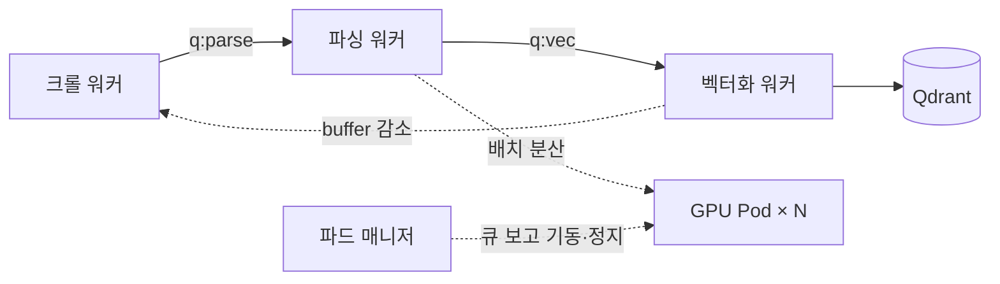

# GPU 6대를 놀리지 않으려면

수천 건의 발굴조사보고서를 벡터 DB에 올려야 했다. 한 건이 200~500페이지고, 스캔 PDF라 전부 GPU를 태워야 한다. GPU 파드를 6대까지 올려두고 며칠에 걸쳐 돌린 작업이었는데, **정작 어려웠던 건 GPU를 늘리는 게 아니라 그 6대를 쉬지 않게 만드는 일**이었다.

## 한 줄로 세워두니 항상 하나만 일했다

처음에는 스크립트 하나로 순서대로 돌렸다. 크롤해서 PDF를 받고, 파싱하고, 임베딩해서 적재하고, 다음 문서로 넘어간다.

문제는 단계마다 병목이 다른 곳에 있다는 점이었다.

| 단계 | 무엇이 한계인가 |
|---|---|
| 크롤 | 상대 서버 응답 속도 |
| 파싱 | GPU |
| 벡터화 | 임베딩 API 한도 |

크롤하는 동안 GPU가 놀고, 임베딩하는 동안에도 GPU가 논다. 한 줄로 세워둔 탓에 **항상 하나만 일하고 나머지는 대기**했다. GPU를 6대로 늘려봐야 노는 시간이 6배로 늘 뿐이다.

## 단계를 떼어내고 큐로 잇다

단계를 각각 독립 워커로 떼어내고, 그 사이를 Redis 큐로 연결했다.

각 워커는 **자기 큐만 본다.** 크롤이 느린 날에도 파싱 워커는 쌓여 있는 걸 계속 먹고, 임베딩이 막혀도 GPU는 다음 문서를 파싱한다. 서로의 속도를 몰라도 되는 구조가 됐다.

## 그런데 크롤러가 너무 빨랐다

큐로 이어놓으니 새 문제가 나왔다. **디스크가 찼다.**

크롤은 제일 가벼운 단계다. 파싱 한 건이 GPU에서 몇 분 걸리는 동안 크롤러는 수십 건을 받아둘 수 있다. 게다가 문서 하나가 원본 PDF, 파싱 결과, 잘라낸 유물 이미지까지 물고 있어서 실제 점유는 PDF 크기보다 훨씬 크다. 생산자가 소비자를 앞지르면 큐는 무한히 자란다.

**역압**을 걸었다. 카운터 하나를 두고 — 크롤은 됐지만 아직 적재되지 않은 문서 수 — 이 값이 목표치를 넘으면 크롤러가 멈춘다. 벡터화 워커가 한 건 적재할 때마다 값이 줄고, 그러면 크롤러가 다시 깨어나 그만큼만 채운다.

핵심은 큐 길이가 아니라 **파이프라인 전체에 떠 있는 문서 수**를 셌다는 점이다. 큐 사이에 있든 워커가 처리 중이든 디스크는 이미 먹고 있으니까. 그리고 적재가 끝나는 즉시 로컬의 PDF·파싱 결과·이미지를 지운다. 수천 건을 전부 남겨둘 디스크는 애초에 없었다.

## 6대에 어떻게 나눠줄 것인가

파싱 워커는 문서를 페이지 배치로 쪼개 파드들에 던진다. 처음엔 순서대로 돌려가며 보냈는데 금방 기울었다. **문서마다 페이지 수가 열 배씩 차이 나서**, 300페이지짜리를 받은 파드가 허덕이는 동안 40페이지를 받은 파드는 이미 놀고 있었다.

지금은 앞에 프록시를 두고 **진행 중인 요청이 가장 적은 파드**로 보낸다. 문서 크기 편차를 미리 알 필요 없이 균형이 알아서 맞는다.

파드 매니저는 따로 돌면서 큐 길이를 본다. 처리할 게 있으면 파드를 켜고, 유휴가 이어지면 끈다. 6대를 계속 켜두면 노는 시간까지 시간당 과금이 그대로 나가기 때문이다.

## 배치 배리어 — 속도보다 재개 가능성

파싱과 벡터화는 큐에서 열 건씩 끊어 가져가고, **그 열 건이 다 끝나야 다음 열 건을 집는다.** 먼저 끝난 슬롯이 다음 문서를 바로 먹는 방식이 이론상 더 빠르다. 그런데도 배리어를 골랐다.

며칠 걸리는 작업에서는 **중간에 끊기는 게 예외가 아니라 기본값**이었다. 배리어를 두면 진행 상태가 배치 단위로 딱 떨어져서, 어디까지 갔는지, 무엇을 다시 넣어야 하는지가 흔들리지 않는다. 파드를 꺼도 되는 시점도 명확해진다. 최대 처리량을 조금 내주고 **재개 가능성을 산 것**이다.

## 같은 일을 두 번 하지 않기

재시작이 잦은 파이프라인에서 멱등성은 안정성 문제가 아니라 **성능 문제**였다. 중복 한 건이 GPU 몇 분이다.

- **큐 중복 발행 차단.** 큐에 넣기 전에 집합에 먼저 넣어보고, 이미 있던 키면 발행하지 않는다.
- **단계별 스킵.** 파싱 결과 파일이 있으면 파싱을 건너뛰고, 이미 적재된 문서면 벡터화를 건너뛴다.
- **크롤 재개 지점 보존.** 어디까지 훑었는지를 Redis에 남긴다. 매 배치 첫 페이지부터 다시 스캔하면 그것만으로 시간이 녹는다. 대신 약간 겹쳐서 읽어 경계에서 빠지는 문서를 막는다.
- **디스크 회수.** 시작할 때 로컬을 훑어 "받아뒀는데 처리되지 않은" PDF를 큐로 되돌린다. 이전 실행에서 끊긴 것들인데, 이미 내려받은 걸 다시 받을 이유가 없다.

## 임베딩에서 막혔고, 워커를 늘리지 않았다

파싱을 6대로 밀어내니 이번엔 벡터화가 밀렸다. 자연스럽게 벡터화 워커를 여러 개 띄웠는데 **429가 쏟아졌다.**

프로세스마다 자기 레이트리미터를 들고 있으니, 각자는 한도를 지켜도 합치면 넘긴다. 그리고 429가 나면 재시도가 붙고, 재시도가 다시 한도를 밀어 올린다. 처리량이 오르기는커녕 떨어졌다.

**벡터화 워커를 하나로 되돌렸다.** 리미터 버킷이 하나뿐이면 한도를 넘길 방법 자체가 없다. 병렬성을 늘리는 대신 한도 바로 아래로 정확히 페이싱해서 **재시도 낭비를 0으로 만드는 쪽**이 실효 처리량이 높았다.

토큰 버킷을 **빈 채로 시작**하게 만든 게 결정적이었다. 버킷이 가득 찬 상태로 출발하면 첫 순간에 대기 중이던 요청들이 한꺼번에 인출해 순간 속도가 치솟고, 시작하자마자 429가 난다. 빈 채로 시작하면 처음부터 일정한 속도로만 흐른다. 여기에 배치 API를 먼저 시도하고 한도에 걸리면 동기 호출로 떨어지는 폴백을 얹었다.

## 스위치 하나로 멈춘다

정지 플래그 하나를 Redis에 둔다. 워커 넷과 파드 매니저가 각자 이 값을 보고 하던 배치를 마무리한 뒤 정리하고 나간다. GPU 파드도 파드 매니저가 내려준다. 며칠 돌아가는 작업에서 **"안전하게 멈추는 방법"이 하나로 정해져 있다는 것**만으로 손이 훨씬 가벼웠다.

## 돌이켜보면

빠르게 돌린다는 건 결국 **자원을 더 붓는 일이 아니라 노는 자원과 중복을 없애는 일**이었다.

실제로 워커를 늘려서 해결된 문제는 하나도 없었다. 오히려 벡터화는 늘렸다가 되돌렸다. 늘린 건 GPU 파드뿐이고, 나머지는 전부 흐름을 정리한 것이다 — 단계를 떼어놓고, 앞서 달리지 못하게 막고, 한 번 한 일을 다시 하지 않게.
