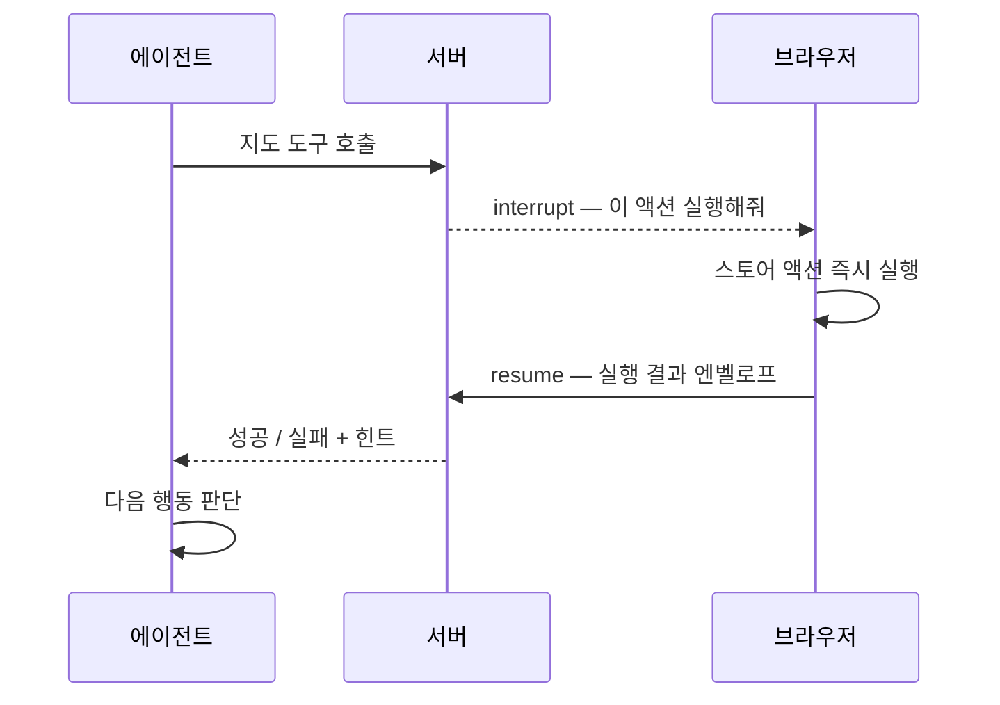

# 에이전트에게 지도를 맡기고, 승인 버튼은 뗐다

발굴보고서는 본질적으로 **장소에 묶인 데이터**다. 연구자가 실제로 던지는 질문도 "청동기시대 주거지가 뭐야"보다 "이 일대에서 발굴된 게 뭐가 있나"에 가깝다. 그런데 텍스트 검색만으로는 이 질문에 답할 수가 없다. 그래서 보고서를 지도 위에 올렸고, 그러자 새로운 문제가 생겼다 — **에이전트는 지도를 볼 수 없다.**

## 서버는 지금 화면에 뭐가 보이는지 모른다

"지금 보이는 영역에서 삼국시대 고분 찾아줘"라는 질문을 받았다고 하자. 서버에는 그 정보가 없다. 사용자가 방금 지도를 어디로 옮겼는지, 얼마나 확대했는지는 브라우저의 상태다.

요청마다 지도 상태를 통째로 실어 보내는 방법도 있었지만, **대부분의 질문에는 필요 없는 데이터**였다. 지도와 무관한 질문이 훨씬 많은데 매 요청에 뷰포트·선택·레이어 상태를 붙이는 건 낭비다.

그래서 반대로 뒤집었다. **필요할 때 서버가 물어본다.** 에이전트가 지도 상태 도구를 부르면 실행이 그 자리에서 멈추고, 프론트엔드가 현재 스냅샷을 잡아서 resume한다. 에이전트 입장에서는 그냥 도구를 하나 부른 것이고, 실제로는 브라우저까지 왕복하고 돌아온 값이다.

## 그다음은 자연스럽게 "조작"으로 넘어갔다

상태를 읽어올 수 있으니 쓰는 것도 같은 배선으로 되지 않을까. 그렇게 지도 도구가 늘었다.

- **뷰 제어** — 특정 좌표로 포커스, 범위에 맞춰 화면 맞춤, 특정 대상 선택
- **공간 검색** — bbox나 GeoJSON 폴리곤을 검색 필터로 받는다. "선택한 영역 안에서"가 그대로 쿼리가 된다
- **객체 생성·삭제** — 핀, 원형 영역, 리스트를 만들고 지운다
- **임시 표시** — 채팅 옆 패널에 핀과 도형을 잠깐 띄운다

여기서 핵심은 **서버가 액션을 서술하기만 하고 실행은 브라우저가 한다**는 점이다. 서버가 DB에 뭘 쓰고 프론트가 폴링해서 반영하는 구조였다면 지도가 늘 한 박자 늦었을 것이다. 대신 프론트의 스토어 액션을 그대로 부르니 **에이전트의 판단과 화면 변화 사이에 지연이 없다.**

## 승인 카드를 달았다가 걷어냈다

처음에는 모든 변경 액션에 승인 카드를 붙였다. 에이전트가 "핀을 여기 찍을까요?" 하고 제안하면 사용자가 버튼을 눌러야 실제로 찍히는 구조다. AI가 내 데이터를 마음대로 바꾸면 안 되니까, 당연한 설계라고 생각했다.

몇 주 쓰고 나서 세 가지가 보였다.

**첫째, 거의 100% 승인한다.** 거절률이 도구 자체의 실패율보다도 낮았다. 사용자가 자기가 방금 시킨 일을 승인하는 건 당연한 일이었다.

**둘째, 카드 클릭이 멀티스텝 작업을 망가뜨린다.** "이 근처 보고서 찾아서 리스트로 묶어줘" 한마디에 검색·핀 생성·리스트 생성이 줄줄이 이어지는데, 매 단계마다 사람이 버튼을 눌러야 했다. 에이전트가 여러 단계를 스스로 처리한다는 장점이 마찰에 다 먹혔다.

**셋째, 모델이 두 개가 됐다.** 지도 상태를 읽는 도구는 똑같은 interrupt 배선을 쓰면서 승인 게이트가 없었다. 같은 통로 위에 "자동 실행"과 "사용자 승인"이 공존하니 코드도 갈라지고, 무엇보다 **머릿속 모델이 갈라졌다.**

그래서 게이트를 전부 뺐다. interrupt의 의미를 "승인 요청"에서 **"클라이언트 실행 프록시"** 하나로 통일했다. 사용자 판단이 필요한 상황은 별도 장치 없이 처리한다 — 에이전트가 그냥 자연어로 묻고, 사용자가 다음 메시지로 답하면 된다. 이미 대화창이 있는데 굳이 다른 채널을 만들 이유가 없었다.

## 실패를 어떻게 돌려줄 것인가

승인 게이트를 빼고 나니 **실패 처리가 중요해졌다.** 사람이 중간에 확인해주지 않으니, 에이전트가 결과를 보고 스스로 판단해야 한다.

모든 지도 도구의 반환을 하나의 엔벨로프로 통일했다. 성공이면 실행된 액션이 딸려오고, 실패면 코드와 메시지, 그리고 **관련 상태 힌트**가 함께 온다. 이 힌트가 핵심이다. "그런 ID의 핀이 없다"로 끝나면 에이전트는 재시도밖에 못 하지만, 지금 존재하는 대상 목록이 같이 오면 **스스로 고쳐서 다시 부르거나, 사용자에게 정확히 무엇이 애매한지 물어볼 수 있다.**

## 보여주기와 저장하기를 도구로 갈랐다

지도에 뭔가 표시하는 일에는 성격이 다른 두 가지가 섞여 있었다. 잠깐 보여주는 것과 사용자 데이터로 저장하는 것이다.

이걸 한 도구의 옵션으로 두면 LLM이 반드시 헷갈린다. 그래서 **아예 다른 도구로 갈랐다.** 임시 표시는 원·사각형·폴리곤 아무 도형이나 자유롭게 쓰고, 다음 호출이 오면 이전 것을 갈아치운다. 저장되는 객체는 형태를 좁게 제한한다. "설명하려고 그리는 것"과 "남기려고 만드는 것"의 제약이 다른 게 당연하고, 도구 이름이 그 차이를 말해주는 편이 프롬프트로 설명하는 것보다 확실했다.

## 돌이켜보면

Human-in-the-Loop를 **기본값처럼 깔면 안 된다**는 걸 배웠다. 승인 게이트는 공짜가 아니라 마찰이라는 비용을 내는 장치고, 그 비용을 낼 만한 액션에만 붙여야 한다.

판단 기준은 결국 **되돌릴 수 있는가**였다. 다른 프로젝트에서는 전화를 걸거나 문자를 보내는 액션에 확인 절차를 뒀는데, 그건 나간 뒤에 주워 담을 수 없기 때문이다. 지도 핀은 마음에 안 들면 지우면 그만이다. 되돌릴 수 있는 액션에 승인 버튼을 다는 건 안전장치가 아니라 그냥 클릭 한 번을 더 요구하는 일이었다.

그리고 게이트를 뺀 자리는 사람이 아니라 **정보로 메꿔야 한다**는 것도 알았다. 실패 엔벨로프에 상태 힌트를 실어 보내는 작업이 승인 카드를 지우는 작업보다 훨씬 오래 걸렸는데, 결과적으로는 그쪽이 진짜 본론이었다.
