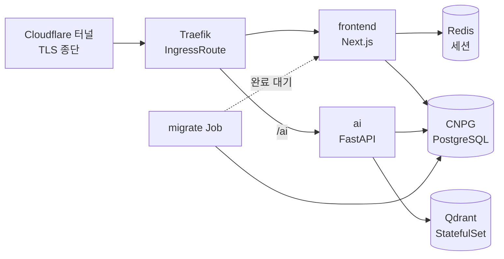

# 관리형을 하나씩 걷어내고 우리 박스로 옮겼다

처음 배포는 전부 관리형이었다. 서버리스 컨테이너 위에 AI 백엔드를 올리고, 이미지는 오브젝트 스토리지에, DB와 인증은 BaaS에, 벡터DB는 SaaS에, 프론트는 PaaS에 뒀다. 그리고 석 달 사이에 이 조합을 **두 번 갈아엎어** 결국 우리 물리 서버의 k3s로 전부 들여왔다.

## 처음엔 관리형이 옳았다

소수 인원이었고 제품이 팔릴지도 확실하지 않았다. 그 상황에서 인프라에 시간을 쓰는 건 낭비다. 요청이 없으면 인스턴스가 0으로 줄어드는 과금 구조가 간헐적으로 쓰이는 연구자용 서비스와도 잘 맞았다.

지금 와서 봐도 이 선택 자체는 틀리지 않았다. 다만 관리형을 고를 때 **나중에 떼어낼 때의 비용을 계산하지 않았다**는 게 문제였다.

## 계정을 하나로 모으는 이전 — 클라우드를 옮겼다

첫 번째 이전은 우리가 먼저 하고 싶어서 한 게 아니었다. 자매 프로젝트가 같은 이전을 먼저 끝냈고, 계정·배포 패턴·시크릿 경로를 통일하면 두 서비스를 한 사람이 볼 수 있었다.

| 옮긴 것 | 전 | 후 |
|---|---|---|
| AI 백엔드 | 서버리스 컨테이너 | VM + Docker |
| 이미지 스토리지 | 오브젝트 스토리지 | S3 |
| 시크릿 | 파라미터 매니저 | 파라미터 스토어 |
| CI 인증 | Workload Identity | GitHub OIDC |
| HTTPS 종단 | 플랫폼 내장 | CDN |

여기서 얻은 건 비용이 아니라 **운영 표면의 통일**이었다. 대신 서버리스를 잃었다 — 이제 요청이 없어도 VM은 켜져 있다. 그럴 만한 값어치가 있었던 건, 이미 인프라를 코드로 관리하기 시작했고 두 서비스가 같은 도구·같은 명령어로 배포된다는 점이었다.

그런데 이 단계에서 옮긴 건 결국 **컴퓨트 하나**였다. 컨테이너 이미지는 그대로였고, 코드는 스토리지 클라이언트만 바꿨다. 진짜 어려운 건 다음이었다.

## DB를 옮기려는데 인증이 발목을 잡았다

다음 목표는 서빙 스택 전체 — 프론트·AI·PostgreSQL·벡터DB·Redis를 전부 우리 박스의 k3s로 들이는 것이었다. 그런데 DB를 옮기려고 보니 앱 테이블이 **BaaS 인증 스키마의 유저 UUID에 FK로 묶여 있었다.** 로그인 플로우 전체도 그 SDK에 결합돼 있었다.

즉 **DB 이전의 선행 조건이 인증 자체 구현**이었다. 순서가 바뀌면 아무것도 안 되는 종류의 의존이다.

- 인증은 Auth.js + Google로 다시 세웠다. 세션은 Redis, 유저·계정은 Postgres에 두는 **합성 어댑터**로 — 매 요청 리다이렉트 게이트가 Redis만 보고 판단하니 커넥션 풀이 인증 경로로 새지 않는다
- 유저 테이블 소유권을 AI 백엔드의 raw SQL에서 프론트엔드 ORM으로 이관했다. 트리거가 유저를 만들던 걸 어댑터가 첫 로그인에 만드는 방식으로 바꾸면서, 유저의 단일 출처가 명확해졌다
- 브라우저 → AI 백엔드 인증은 **단명 앱 JWT**로 바꿨다. 세션 콜백이 대칭키로 서명한 짧은 토큰을 발급하고, FastAPI는 이걸 공유 시크릿으로 검증한다. 외부 IdP의 공개키를 받아 캐싱하던 코드가 통째로 사라졌다
- 유저는 UUID를 보존해 백필했다. 기존 FK가 그대로 유효하고, 사용자는 같은 구글 계정으로 재로그인하면 원래 데이터를 그대로 본다

로그인 방식이 구글 하나뿐이라 **비밀번호 해시를 옮길 일이 없었다는 게** 이 이전의 가장 큰 행운이었다.

## 클러스터에 올리기

Kustomize를 base + 오버레이(local·dev·prod)로 나눴다. 로컬은 k3d에 그대로 올라가고, 오버레이가 호스트·네임스페이스·이미지 태그만 갈아끼운다. 인증서는 필요 없었다 — 터널이 TLS를 종단하고 클러스터 안은 평문이다.

두 가지가 특히 신경 쓰였다. 하나는 **마이그레이션 순서**로, 스키마 변경을 Job으로 돌리고 앱 파드는 initContainer로 그 완료를 기다리게 했다. 다른 하나는 **RAM**이다. 벡터DB를 그냥 올리면 벡터가 통째로 메모리에 상주하는데, 같은 박스를 이웃 서비스와 나눠 쓰는 상황에서 그건 예의가 아니었다. int8 양자화 + 디스크 상주로 눌렀다.

## 언제든 통째로 이사 갈 수 있게

같은 물리 서버에 자매 프로젝트와 공존하되, **언제든 새 박스로 통째로 옮길 수 있어야 한다**는 제약을 최상위에 뒀다. 규칙은 하나였다 — 교차 참조 0.

모든 리소스에 프로젝트 접두를 붙이고, 서비스 참조는 전부 네임스페이스 로컬로 했다. 시크릿 경로도 백업 프리픽스도 분리했다. 검증 방법이 단순해서 좋았다: **매니페스트와 스크립트 어디에도 상대 프로젝트 이름이 문자열로 등장하지 않을 것.**

상태 데이터는 얘기가 다르다. 로컬 경로 PVC는 노드에 고정되니, 이사 수단은 결국 백업과 복원밖에 없다. 그래서 백업 기계장치를 만드는 일이 곧 이사 준비를 겸하게 됐다.

## 배포가 박스 안에서 돈다

이미지 레지스트리를 두지 않았다. 셀프호스트 러너가 박스 위에 있으니 거기서 빌드해서 containerd에 바로 import하면 끝이다. 시크릿은 OIDC로 클라우드 파라미터 스토어에서 끌어와 env 파일로 seed하는데, **비어 있으면 즉시 실패**시킨다. 조용히 빈 값으로 배포되는 것보다 낫다.

스모크 테스트도 러너가 박스 안이라는 걸 이용했다. 공개 DNS를 타지 않고 localhost의 인그레스에 Host 헤더를 붙여 때린다. DNS나 터널 상태와 무관하게 **방금 올린 파드가 응답하는지**만 본다.

## 밟은 지뢰들

**마이그레이션 저널** — 덤프를 복원하면 마이그레이션 추적 테이블까지 딸려온다. 그 상태로 migrate Job을 돌리면 이미 적용된 걸 다시 실행하다 죽는다. 복원 후 추적행을 먼저 대조하는 게 필수였다.

**경로 접두 매칭** — AI 백엔드를 `/ai`로 라우팅했는데 접두 매칭이 프론트의 다른 라우트까지 삼켰다. 정확 매칭과 슬래시 포함 접두를 함께 걸어 좁혔다.

**www에서 로그인이 안 됐다** — 인증 URL을 apex로 고정해뒀으니 www로 들어온 사용자는 쿠키가 어긋난다. 301 리다이렉트가 선택이 아니라 필수였다.

**이미지가 사라졌다** — 레지스트리 없이 로컬 이미지만 쓰는 구조에서 kubelet의 이미지 GC가 돌면 pull해올 곳이 없어 **영구 소실**이다. 디스크 사용률이 임계를 넘자 실제로 GC가 이미지를 지웠고, 며칠간 ImagePullBackOff가 났다. 배포 때 pinned 라벨을 찍어 GC 대상에서 빼는 것으로 막았다. 태그를 잃은 구버전은 라벨이 없으니 정상적으로 정리된다.

## 돌이켜보면

컴퓨트를 옮기는 건 쉬웠다. 서버리스 컨테이너에서 VM으로 갈 때 이미지는 그대로였고 바뀐 건 배포 스크립트뿐이었다.

어려웠던 건 인증이었다. **파일 59개를 건드려서 24개를 새로 쓰고 16개를 지웠다.** 컴퓨트는 이미지가 경계를 만들어주지만, 인증은 로그인 UI부터 미들웨어, JWT 검증, 유저 테이블 소유권, FK까지 코드 전체에 실핏줄처럼 퍼져 있었다.

관리형을 고를 때 실제로 재야 하는 건 월 요금이 아니라 **떼어낼 때 뜯어야 하는 코드의 양**이다. 스토리지처럼 인터페이스가 좁은 건 언제든 바꿀 수 있고, 인증처럼 앱 전체에 스며드는 건 처음부터 우리 것으로 두거나 최소한 얇은 층으로 감싸뒀어야 했다.
