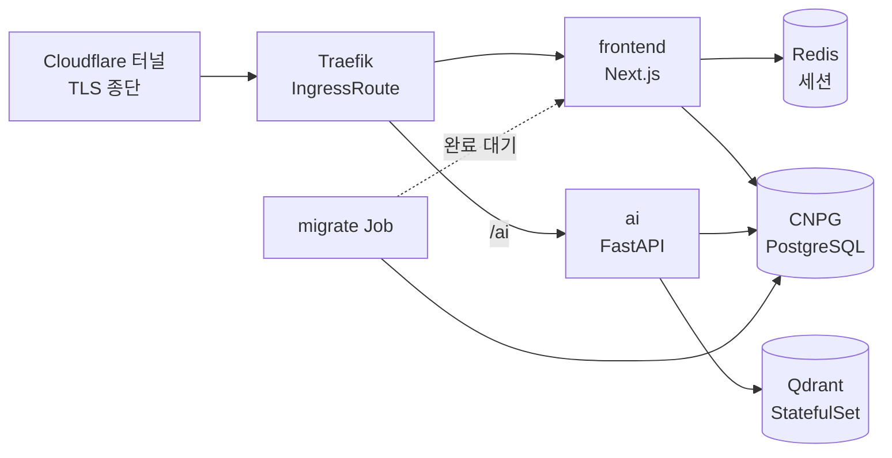

# 클라우드에서 온프레미스로의 여정

인프라를 옮기기로 한 이유는 아키텍처가 아니었다. **벡터DB 요금이었다.**

처음 배포는 전부 관리형이었다. AI 백엔드는 서버리스 컨테이너에, 이미지는 오브젝트 스토리지에, DB와 인증은 BaaS에, 벡터DB는 SaaS에, 프론트는 PaaS에 뒀다. 소수 인원이었고 제품이 팔릴지도 확실하지 않았으니, 그 상황에서 인프라에 시간을 쓰는 건 낭비였다. 중간에 클라우드를 한 번 옮기긴 했지만 그건 컴퓨트를 어디서 돌릴지의 문제였고, **데이터는 계속 남의 서비스에 있었다.**

그러다 데이터가 늘기 시작했다.

## 벡터DB 디스크가 먼저 찼다

발굴보고서 8,000건을 목표로 인제스션을 돌리던 중이었다. 어느 시점에 벡터DB 콘솔을 보니 노드 디스크 4GiB 중 2.7GiB가 차 있었다. **남은 여유가 1.3GiB.** 청크만 23만 개가 넘어가 있었고, 적재는 아직 한참 남아 있었다.

문제는 그 상태에서 **스냅샷조차 뜰 수 없었다**는 것이다. 스냅샷은 노드 디스크에 컬렉션 크기만큼 임시 파일을 쓰는데, 그럴 여유가 없었다. 백업을 뜨려는 시도가 곧 디스크를 터뜨리는 상황이라, 데이터를 꺼내려면 API로 한 페이지씩 긁어내는 수밖에 없었다.

더 답답했던 건 **이미 쥐어짤 수 있는 건 다 쥐어짠 상태**였다는 점이다. 벡터는 int8로 양자화해뒀고 디스크 상주도 켜둔 뒤였다. 최적화를 다 하고도 벽에 부딪혔다면 남은 선택지는 요금제를 올리는 것뿐이다.

그런데 여기서 계산이 이상해졌다. Bonda는 **적재량이 늘수록 좋아지는 제품**이다. 보고서를 많이 넣을수록 검색이 쓸모 있어진다. 그런데 관리형 요금은 정확히 그 방향으로 올라간다. 제품이 목표대로 성장하면 그만큼 비용이 따라 붙고, 그 비용은 사용자 수가 아니라 **쌓아둔 데이터에 매겨진다.** 연구자들이 간헐적으로 쓰는 서비스라 트래픽은 얼마 되지도 않는데 말이다.

성능이 부족한 게 아니라 **과금 축이 제품과 어긋나 있었다.** 그건 요금제로 풀 문제가 아니었다.

## 프로덕션을 건드리지 않고, 먼저 로컬에 복사해봤다

바로 이전을 결정한 건 아니다. 그때 당장 급했던 건 다른 문제였다 — 수집 파이프라인을 손보고 평가를 돌리려면 데이터가 필요한데, 포화된 프로덕션 벡터DB를 개발용으로 두드릴 수는 없었다.

그래서 **로컬 미러**를 먼저 만들었다. 클라우드에서 로컬로 단방향 복사만 하는 개발 스택이다. 벡터DB는 페이지 단위로 긁어 옮기고, 관계형 데이터는 통째로 복사하고, 큐까지 묶어서 컴포즈 하나로 띄웠다. 클라우드에는 **쓰기 API를 아예 호출하지 않도록** 스크립트를 짰다.

목적은 개발 환경 확보였는데, 만들고 나니 예상 못 한 게 보였다. **같은 데이터가 우리 디스크에서는 아무 제약 없이 돌았다.** 용량 걱정도, 스냅샷이 터질 걱정도 없었다. 양자화를 꺼도 됐다.

그러니까 자연스럽게 질문이 따라왔다 — *개발에서 되는 게 왜 프로덕션에서는 안 되지?*

디스크는 사면 그만이고, 벡터DB는 원래 셀프호스팅이 되는 물건이다. 관리형에 내던 값은 그 운영을 대신 해주는 대가였는데, 우리는 이미 로컬 스택을 굴리면서 그 운영의 상당 부분을 해본 뒤였다. 서빙 스택 전체를 우리 박스로 들이기로 했다.

## DB를 옮기려는데 인증이 발목을 잡았다

계획은 단순했다. 프론트·AI·PostgreSQL·벡터DB·Redis를 전부 우리 박스로. 그런데 DB를 옮기려고 스키마를 열어보니 앱 테이블이 **BaaS 인증 스키마의 유저 UUID에 FK로 묶여 있었다.** 로그인 플로우 전체도 그 SDK에 결합돼 있었다.

즉 **DB 이전의 선행 조건이 인증 자체 구현**이었다. 순서가 바뀌면 아무것도 안 되는 종류의 의존이다.

- 인증은 Auth.js + Google로 다시 세웠다. 세션은 Redis, 유저·계정은 Postgres에 두는 **합성 어댑터**로 — 매 요청 리다이렉트 게이트가 Redis만 보고 판단하니 커넥션 풀이 인증 경로로 새지 않는다
- 유저 테이블 소유권을 AI 백엔드의 raw SQL에서 프론트엔드 ORM으로 이관했다. 트리거가 유저를 만들던 걸 어댑터가 첫 로그인에 만드는 방식으로 바꾸면서, 유저의 단일 출처가 명확해졌다
- 브라우저 → AI 백엔드 인증은 **단명 앱 JWT**로 바꿨다. 세션 콜백이 대칭키로 서명한 짧은 토큰을 발급하고, FastAPI는 이걸 공유 시크릿으로 검증한다. 외부 IdP의 공개키를 받아 캐싱하던 코드가 통째로 사라졌다
- 유저는 UUID를 보존해 백필했다. 기존 FK가 그대로 유효하고, 사용자는 같은 구글 계정으로 재로그인하면 원래 데이터를 그대로 본다

로그인 방식이 구글 하나뿐이라 **비밀번호 해시를 옮길 일이 없었다는 게** 이 이전의 가장 큰 행운이었다.

## 왜 컴포즈가 아니라 쿠버네티스였나

개발용 미러는 컴포즈로 충분했다. 프로덕션도 그러면 되지 않나 싶었는데, 요구사항을 적어보니 넘어갔다.

**기동 순서에 의존이 있었다.** 스키마 마이그레이션이 끝나야 앱이 뜰 수 있고, DB가 준비돼야 마이그레이션이 돌 수 있다. 컴포즈의 의존 선언은 "컨테이너가 떴다"까지만 보장하지 "작업이 끝났다"를 기다려주지 않는다.

**자원 상한이 필요했다.** 같은 물리 서버를 이웃 서비스와 나눠 쓰기 때문에, 한쪽이 메모리를 먹어치우면 다른 쪽이 죽는다. 특히 벡터DB는 그냥 올리면 벡터가 통째로 RAM에 상주한다. 파드마다 요청량과 상한을 명시할 수 있어야 했다.

**환경이 세 개였다.** 로컬·개발·운영이 호스트와 이름공간, 이미지 태그만 다르고 나머지는 같다. 같은 정의에서 파생시키고 차이만 덧씌우는 방식이 필요했다.

**언제든 다른 박스로 옮길 수 있어야 했다.** 선언적으로 적어두면 그 정의 자체가 이삿짐이 된다.

그래서 k3s에 Kustomize로 base와 환경별 오버레이를 뒀다.

인증서는 필요 없었다. 터널이 TLS를 종단하고 클러스터 안은 평문이다. 마이그레이션은 Job으로 돌리고 앱 파드는 initContainer로 완료를 기다린다. 벡터DB는 이웃을 배려해 양자화와 디스크 상주를 다시 켰다 — 로컬 미러에서는 껐던 걸, 자원을 나눠 쓰는 프로덕션에서는 도로 켠 셈이다.

배포도 박스 안에서 돌게 했다. 이미지 레지스트리를 두지 않고, 셀프호스트 러너가 그 자리에서 빌드해 containerd에 바로 import한다. 시크릿은 OIDC로 클라우드 파라미터 스토어에서 끌어와 env 파일로 seed하는데 **비어 있으면 즉시 실패**시킨다. 조용히 빈 값으로 배포되는 것보다 낫다.

그리고 같은 박스를 쓰는 이웃 서비스와는 **교차 참조를 0으로** 못 박았다. 모든 리소스에 프로젝트 접두를 붙이고, 서비스 참조는 전부 이름공간 로컬로. 검증 방법이 단순해서 좋았다 — 매니페스트와 스크립트 어디에도 상대 프로젝트 이름이 문자열로 등장하지 않을 것.

## 이제 복구 버튼이 없다

여기까지 하고 나서야 빠진 게 보였다.

관리형 DB를 쓸 때는 백업을 생각해본 적이 없다. 콘솔에 시점 복구 버튼이 있었고, 그게 있다는 사실조차 의식하지 않았다. 로그도 마찬가지다. 플랫폼이 알아서 모아주고 검색까지 붙여줬다.

우리 디스크로 들어오면서 **그 안전망이 통째로 사라졌다.** 그런데 이건 이전의 후속 과제가 아니라 **이전이 끝났다고 말하기 위한 조건**이었다. 데이터를 우리 디스크에 올려놓고 백업이 없으면, 그건 이전이 아니라 그냥 위험을 떠안은 것이다.

애초에 이 여정의 출발점을 생각하면 아이러니했다. **디스크가 차서 스냅샷도 못 뜨는 상황**이 싫어서 나왔는데, 나오고 나니 스냅샷을 뜰 사람이 우리밖에 없었다.

## 무엇이 어떻게 사라지는지부터 적었다

백업 도구를 고르기 전에 사고 시나리오를 나열했다. 각각 필요한 게 달랐다.

| 사고 | 필요한 것 |
|---|---|
| 잘못된 쿼리로 데이터를 날림 | 사고 **직전 시점**으로 되감기 |
| 파드·노드가 통째로 죽음 | 최근 전체 사본 |
| 몇 주 전 상태와 대조해야 함 | 시점별로 남은 사본 |
| 이미지 파일을 실수로 지움 | 지운 객체 자체의 복구 |
| 서버를 다른 박스로 옮겨야 함 | 옮길 수 있는 형태의 사본 |

한 가지 방식으로 다 커버되지 않는다는 게 분명해져서 층을 나눴다.

- **물리 백업** — WAL과 베이스 백업으로 시점 복구. 되감기가 필요한 사고를 담당한다
- **논리 덤프** — 주간·월간으로 따로 뜬다. 물리 백업이 클러스터 구성에 묶여 있는 데 반해, 덤프는 어디에든 부어넣을 수 있다
- **벡터DB 스냅샷** — 전체 컬렉션을 주기적으로 떠서 오브젝트 스토리지로. 이제 디스크가 넉넉하니 예전처럼 터지지 않는다
- **오브젝트 소프트 삭제** — 버저닝을 켜고 비현행 버전을 일정 기간 남긴다. 지운 파일을 되살리는 스크립트도 함께

운영 환경은 보관 기간을 길게, 개발 환경은 짧게 뒀다. 개발 데이터는 언제든 다시 만들 수 있는 미러라 오래 보관해봐야 비용만 쌓인다.

표의 마지막 줄은 덤으로 얻었다. 볼륨이 노드에 고정돼 있어 **다른 박스로 옮길 방법이 백업과 복원밖에 없는데**, 재해 대비로 만든 장치가 그대로 이사 수단이 됐다.

## 백업이 안 돌았다는 건 로그에 안 남는다

백업을 붙여놓고 나니 다음 질문이 왔다. *이게 진짜 돌고 있나?*

**백업 잡이 실패하면 로그가 남지만, 아예 안 돌면 아무것도 안 남는다.** 크론이 등록이 안 됐거나, 이미지를 못 받아왔거나, 이름공간이 어긋났으면 실패 로그조차 없다. 조용한 게 정상인지 고장인지 구분이 안 된다.

그러니까 실패를 감시하는 것으로는 부족했다. **성공이 없는 상태를 감시해야 했다.**

감사 잡이 주기적으로 백업 저장소를 뒤져서 최근 백업이 있는지 확인하고, 있으면 정상 신호를 로그로 남긴다. 알림 규칙은 반대로 건다 — **그 신호가 들어오지 않으면 경보.** 데이터 없음을 정상이 아니라 경보로 취급하는 게 핵심이다. 이 방식은 감시 자체가 죽어도 알아차린다. 감사 잡이 안 돌면 신호가 없고, 신호가 없으면 알림이 울린다.

## 신호가 흐르려면 로그가 한곳에 모여야 했다

그런데 이 알림을 걸려면 **로그가 어딘가에 모여 있어야** 했다. 백업이 도는지 보려고 시작한 일이 결국 관측성 스택 전체를 세우는 일이 됐다.

각 앱은 요청 하나당 구조화된 이벤트 하나를 표준 출력으로 뱉는다. 수집기가 파드 로그를 tail해서 파싱하고 로그 저장소로 밀어 넣는다. 파일 sink도 사이드카도 없다 — 앱은 그냥 stdout에 찍고 나머지는 플랫폼이 한다.

여기서 한 번 데인 게 **라벨 규칙**이다. 로그 저장소의 라벨은 인덱스라서, 값 종류가 많은 필드를 라벨로 올리면 인덱스가 폭발한다. 요청 ID나 사용자 ID처럼 값이 무한히 늘어나는 건 **라벨 금지, 본문에 두고 쿼리 시점에 파싱**하기로 못 박았다.

그리고 또 빈틈이 있었다. **파드가 죽으면 로그가 끊길 뿐, 죽었다는 사실이 로그로 오지 않는다.** 백업 때와 같은 구조의 문제다. 그래서 클러스터 이벤트를 따로 내보내는 컴포넌트를 붙였다. 로그가 "무슨 일이 있었나"를 말해준다면, 이쪽은 **"살아 있나"**를 말해준다.

여기에 에러·경고 로그와 느린 요청 알림을 얹었다. 임계값은 넉넉하게 잡았다 — 처음부터 촘촘하게 걸면 알림이 배경 소음이 되고, 배경 소음이 된 알림은 없는 것과 같다.

## 밟은 지뢰들

**마이그레이션 저널** — 덤프를 복원하면 마이그레이션 추적 테이블까지 딸려온다. 그 상태로 migrate Job을 돌리면 이미 적용된 걸 다시 실행하다 죽는다. 복원 후 추적행을 먼저 대조하는 게 필수였다.

**경로 접두 매칭** — AI 백엔드를 `/ai`로 라우팅했는데 접두 매칭이 프론트의 다른 라우트까지 삼켰다. 정확 매칭과 슬래시 포함 접두를 함께 걸어 좁혔다.

**www에서 로그인이 안 됐다** — 인증 URL을 apex로 고정해뒀으니 www로 들어온 사용자는 쿠키가 어긋난다. 301 리다이렉트가 선택이 아니라 필수였다.

**이미지가 사라졌다** — 레지스트리 없이 로컬 이미지만 쓰는 구조에서 kubelet의 이미지 GC가 돌면 pull해올 곳이 없어 **영구 소실**이다. 디스크 사용률이 임계를 넘자 실제로 GC가 이미지를 지웠고, 며칠간 ImagePullBackOff가 났다. 배포 때 pinned 라벨을 찍어 GC 대상에서 빼는 것으로 막았다.

**보관 정책을 아무 데나 걸면 안 된다** — 물리 백업은 베이스와 WAL이 서로를 필요로 하는데, 스토리지 수명 정책이 그중 일부를 지우면 남은 것도 못 쓴다. 정합성은 백업 도구가 보장하도록 두고, 그 경로에는 수명 정책을 걸지 않았다.

**권한을 좁히다 백업이 멈췄다** — 백업 계정에 특정 경로만 허용하도록 조건을 걸었더니, 도구가 버킷 자체를 확인하는 호출에서 막혔다. 좁게 주는 게 항상 옳은 건 아니고, 도구가 실제로 뭘 호출하는지를 봐야 했다.

## 돌이켜보면

시작은 요금 청구서였는데 끝은 운영 인수였다.

옮기는 일 자체는 생각보다 쉬웠다. 컴퓨트는 이미지가 경계를 만들어주니 거의 그대로 옮겨졌다. 어려웠던 건 인증이다 — **파일 59개를 건드려서 24개를 새로 쓰고 16개를 지웠다.** 컴퓨트는 컨테이너 하나로 잘리는데, 인증은 로그인 UI부터 미들웨어, JWT 검증, 유저 테이블 소유권, FK까지 코드 전체에 실핏줄처럼 퍼져 있었다.

그리고 진짜 오래 걸린 건 코드가 아니라 **관리형이 조용히 대신 해주던 일을 인수하는 쪽**이었다. 백업을 뜨는 건 하루면 되는데 이걸로 정말 되살릴 수 있는지 확인하는 데 훨씬 오래 걸렸고, 로그 파이프라인은 백업이 도는지 보려다 스택 하나가 됐다.

관리형을 고를 때 실제로 재야 하는 건 지금 월 요금이 아니라 **과금 축이 제품이 자라는 방향과 같은가**, 그리고 **떼어낼 때 뜯어야 하는 코드와 인수하게 될 운영의 양**이다. 우리는 데이터가 쌓일수록 좋아지는 제품을 만들면서, 데이터가 쌓일수록 비싸지는 곳에 그 데이터를 뒀다. 그 어긋남을 청구서가 알려줄 때까지 몰랐던 게 이 여정의 진짜 교훈이다.
