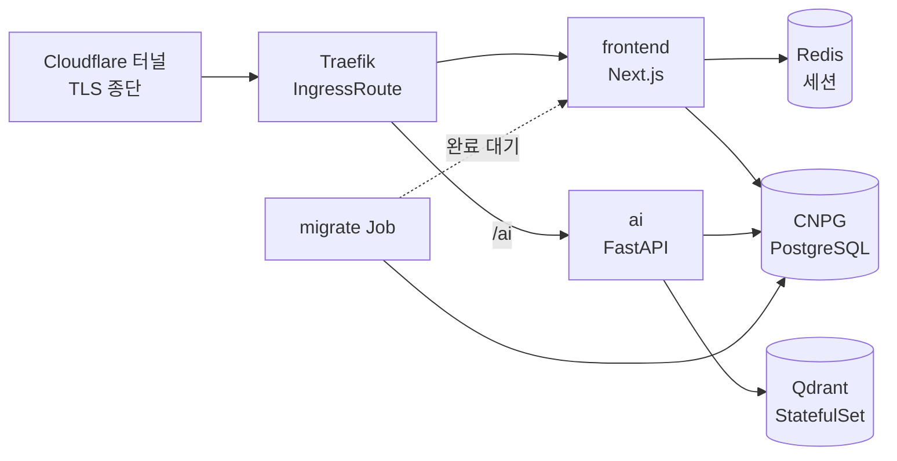

# 클라우드를 떠나며 인수한 것들

처음 배포는 전부 관리형이었다. 서버리스 컨테이너 위에 AI 백엔드를 올리고, 이미지는 오브젝트 스토리지에, DB와 인증은 BaaS에, 벡터DB는 SaaS에, 프론트는 PaaS에 뒀다. 그리고 석 달 사이에 이 조합을 **두 번 갈아엎어** 결국 우리 물리 서버의 k3s로 전부 들여왔다.

옮기는 일 자체보다 오래 걸린 건 **그동안 관리형이 대신 해주던 일을 인수하는 쪽**이었다.

## 처음엔 관리형이 옳았다

소수 인원이었고 제품이 팔릴지도 확실하지 않았다. 그 상황에서 인프라에 시간을 쓰는 건 낭비다. 요청이 없으면 인스턴스가 0으로 줄어드는 과금 구조가 간헐적으로 쓰이는 연구자용 서비스와도 잘 맞았다.

지금 와서 봐도 이 선택 자체는 틀리지 않았다. 다만 관리형을 고를 때 **나중에 떼어낼 때의 비용을 계산하지 않았다**는 게 문제였다.

## 클라우드를 옮겼는데, 옮겨진 건 컴퓨트 하나였다

첫 번째 이전은 우리가 먼저 하고 싶어서 한 게 아니었다. 자매 프로젝트가 같은 이전을 먼저 끝냈고, 계정·배포 패턴·시크릿 경로를 통일하면 두 서비스를 한 사람이 볼 수 있었다.

| 옮긴 것 | 전 | 후 |
|---|---|---|
| AI 백엔드 | 서버리스 컨테이너 | VM + Docker |
| 이미지 스토리지 | 오브젝트 스토리지 | S3 |
| 시크릿 | 파라미터 매니저 | 파라미터 스토어 |
| CI 인증 | Workload Identity | GitHub OIDC |
| HTTPS 종단 | 플랫폼 내장 | CDN |

여기서 얻은 건 비용이 아니라 **운영 표면의 통일**이었다. 대신 서버리스를 잃었다 — 이제 요청이 없어도 VM은 켜져 있다.

그런데 이 단계에서 실제로 옮긴 건 결국 **컴퓨트 하나**였다. 컨테이너 이미지는 그대로였고, 코드는 스토리지 클라이언트만 바꿨다. 한 달쯤 지나서야 이게 왜 쉬웠는지 알았다 — **이미지가 경계를 만들어주는 것만 옮겼기 때문이다.**

## DB를 옮기려는데 인증이 발목을 잡았다

다음 목표는 서빙 스택 전체 — 프론트·AI·PostgreSQL·벡터DB·Redis를 전부 우리 박스의 k3s로 들이는 것이었다. 그런데 DB를 옮기려고 보니 앱 테이블이 **BaaS 인증 스키마의 유저 UUID에 FK로 묶여 있었다.** 로그인 플로우 전체도 그 SDK에 결합돼 있었다.

즉 **DB 이전의 선행 조건이 인증 자체 구현**이었다. 순서가 바뀌면 아무것도 안 되는 종류의 의존이다.

- 인증은 Auth.js + Google로 다시 세웠다. 세션은 Redis, 유저·계정은 Postgres에 두는 **합성 어댑터**로 — 매 요청 리다이렉트 게이트가 Redis만 보고 판단하니 커넥션 풀이 인증 경로로 새지 않는다
- 유저 테이블 소유권을 AI 백엔드의 raw SQL에서 프론트엔드 ORM으로 이관했다. 트리거가 유저를 만들던 걸 어댑터가 첫 로그인에 만드는 방식으로 바꾸면서, 유저의 단일 출처가 명확해졌다
- 브라우저 → AI 백엔드 인증은 **단명 앱 JWT**로 바꿨다. 세션 콜백이 대칭키로 서명한 짧은 토큰을 발급하고, FastAPI는 이걸 공유 시크릿으로 검증한다. 외부 IdP의 공개키를 받아 캐싱하던 코드가 통째로 사라졌다
- 유저는 UUID를 보존해 백필했다. 기존 FK가 그대로 유효하고, 사용자는 같은 구글 계정으로 재로그인하면 원래 데이터를 그대로 본다

로그인 방식이 구글 하나뿐이라 **비밀번호 해시를 옮길 일이 없었다는 게** 이 이전의 가장 큰 행운이었다.

## 클러스터에 올리기

Kustomize를 base + 오버레이(local·dev·prod)로 나눴다. 로컬은 k3d에 그대로 올라가고, 오버레이가 호스트·네임스페이스·이미지 태그만 갈아끼운다. 인증서는 필요 없었다 — 터널이 TLS를 종단하고 클러스터 안은 평문이다.

두 가지가 특히 신경 쓰였다. 하나는 **마이그레이션 순서**로, 스키마 변경을 Job으로 돌리고 앱 파드는 initContainer로 그 완료를 기다리게 했다. 다른 하나는 **RAM**이다. 벡터DB를 그냥 올리면 벡터가 통째로 메모리에 상주하는데, 같은 박스를 이웃 서비스와 나눠 쓰는 상황에서 그건 예의가 아니었다. int8 양자화 + 디스크 상주로 눌렀다.

배포는 아예 박스 안에서 돌게 했다. 이미지 레지스트리를 두지 않고, 셀프호스트 러너가 그 자리에서 빌드해 containerd에 바로 import한다. 시크릿은 OIDC로 클라우드 파라미터 스토어에서 끌어와 env 파일로 seed하는데 **비어 있으면 즉시 실패**시킨다. 조용히 빈 값으로 배포되는 것보다 낫다. 스모크 테스트도 러너가 박스 안이라는 걸 이용해서, 공개 DNS를 타지 않고 localhost의 인그레스에 Host 헤더를 붙여 때린다.

## 언제든 통째로 이사 갈 수 있게

같은 물리 서버에 자매 프로젝트와 공존하되, **언제든 새 박스로 통째로 옮길 수 있어야 한다**는 제약을 최상위에 뒀다. 규칙은 하나였다 — 교차 참조 0.

모든 리소스에 프로젝트 접두를 붙이고, 서비스 참조는 전부 네임스페이스 로컬로 했다. 시크릿 경로도 백업 프리픽스도 분리했다. 검증 방법이 단순해서 좋았다: **매니페스트와 스크립트 어디에도 상대 프로젝트 이름이 문자열로 등장하지 않을 것.**

그런데 상태 데이터에서 이 계획이 막혔다. 로컬 경로 볼륨은 노드에 고정되니, 데이터를 옮길 방법이 **백업과 복원밖에 없다.** 이사 계획을 세우다가 백업 얘기로 넘어온 셈인데, 사실 그때 이미 백업은 훨씬 급한 문제가 돼 있었다.

## 관리형이 해주던 일이 전부 내 앞에 왔다

관리형 DB를 쓸 때는 백업을 생각해본 적이 없다. 콘솔에 시점 복구 버튼이 있었고, 그게 있다는 사실조차 의식하지 않았다. 로그도 마찬가지다. 플랫폼이 알아서 모아주고 검색까지 붙여줬다.

자체 클러스터로 들어오면서 **그 안전망이 통째로 사라졌다.** 이건 이전 작업의 후속 과제가 아니라 **이전이 끝났다고 말하기 위한 조건**이었다. 데이터를 우리 디스크에 올려놓고 백업이 없으면, 그건 이전이 아니라 그냥 위험을 떠안은 것이다.

돌아보면 클라우드를 떠나는 비용은 요금 차액이 아니었다. **관리형이 조용히 대신 해주던 운영을 하나씩 인수하는 일**이 진짜 청구서였다.

## 무엇이 어떻게 사라지는지부터 적었다

백업 도구를 고르기 전에 사고 시나리오를 나열했다. 각각 필요한 게 달랐다.

| 사고 | 필요한 것 |
|---|---|
| 잘못된 쿼리로 데이터를 날림 | 사고 **직전 시점**으로 되감기 |
| 파드·노드가 통째로 죽음 | 최근 전체 사본 |
| 몇 주 전 상태와 대조해야 함 | 시점별로 남은 사본 |
| 이미지 파일을 실수로 지움 | 지운 객체 자체의 복구 |
| 서버를 다른 박스로 옮겨야 함 | 옮길 수 있는 형태의 사본 |

한 가지 방식으로 다 커버되지 않는다는 게 분명해져서, **층을 나눴다.**

- **물리 백업** — WAL과 베이스 백업으로 시점 복구. 되감기가 필요한 사고를 담당한다
- **논리 덤프** — 주간·월간으로 따로 뜬다. 물리 백업이 클러스터 구성에 묶여 있는 데 반해, 덤프는 어디에든 부어넣을 수 있다
- **벡터DB 스냅샷** — 전체 컬렉션을 주기적으로 떠서 오브젝트 스토리지로
- **오브젝트 소프트 삭제** — 버저닝을 켜고 비현행 버전을 일정 기간 남긴다. 지운 파일을 되살리는 스크립트도 함께

운영 환경은 보관 기간을 길게, 개발 환경은 짧게 뒀다. 개발 데이터는 언제든 다시 만들 수 있는 미러라, 오래 보관해봐야 비용만 쌓인다.

그리고 마지막 줄이 앞의 이사 문제를 해결했다. **옮길 수 있는 형태의 사본**은 재해 대비로 만든 게 아니라 이사 수단으로 필요했던 건데, 결국 같은 장치였다.

## 백업이 안 돌았다는 건 로그에 안 남는다

여기서 진짜 문제가 나온다. **백업 잡이 실패하면 로그가 남지만, 아예 안 돌면 아무것도 안 남는다.** 크론이 등록이 안 됐거나, 이미지를 못 받아왔거나, 네임스페이스가 통째로 어긋났으면 실패 로그조차 없다.

그러니까 실패를 감시하는 것으로는 부족했다. **성공이 없는 상태를 감시해야 했다.**

감사 잡이 주기적으로 백업 저장소를 뒤져서 최근 백업이 있는지 확인하고, 있으면 정상 신호를 로그로 남긴다. 알림 규칙은 반대로 건다 — **그 신호가 들어오지 않으면 경보.** 데이터 없음을 정상이 아니라 경보로 취급하는 게 핵심이다. 이 방식은 감시 자체가 죽어도 알아차린다. 감사 잡이 안 돌면 신호가 없고, 신호가 없으면 알림이 울린다.

## 신호가 흐르려면 로그가 한곳에 모여야 했다

deadman을 붙이려니 그 전제로 관측성 스택이 필요했다. 백업 때문에 시작한 일이 결국 로그 파이프라인 전체를 세우는 일이 됐다.

각 앱은 요청 하나당 구조화된 이벤트 하나를 표준 출력으로 뱉는다. 수집기가 파드 로그를 tail해서 파싱하고, 로그 저장소로 밀어 넣는다. 파일 sink도 사이드카도 없다 — 앱은 그냥 stdout에 찍고 나머지는 플랫폼이 한다.

여기서 한 번 데인 게 **라벨 규칙**이다. 로그 저장소의 라벨은 인덱스라서, 값 종류가 많은 필드를 라벨로 올리면 인덱스가 폭발한다. 요청 ID나 사용자 ID처럼 값이 무한히 늘어나는 건 **라벨 금지, 본문에 두고 쿼리 시점에 파싱**하기로 규칙을 못 박았다.

그리고 또 빈틈이 있었다. **파드가 죽으면 로그가 끊길 뿐, 죽었다는 사실이 로그로 오지 않는다.** 조용해지는 게 전부라 트래픽 없는 시간대와 구분이 안 된다. 그래서 클러스터 이벤트를 따로 내보내는 컴포넌트를 붙였다. 로그가 "무슨 일이 있었나"를 말해준다면, 이쪽은 **"살아 있나"**를 말해준다.

여기에 에러·경고 로그와 느린 요청 알림을 얹었다. 임계값은 넉넉하게 잡았다 — 처음부터 촘촘하게 걸면 알림이 배경 소음이 되고, 배경 소음이 된 알림은 없는 것과 같다.

## 밟은 지뢰들

**마이그레이션 저널** — 덤프를 복원하면 마이그레이션 추적 테이블까지 딸려온다. 그 상태로 migrate Job을 돌리면 이미 적용된 걸 다시 실행하다 죽는다. 복원 후 추적행을 먼저 대조하는 게 필수였다.

**경로 접두 매칭** — AI 백엔드를 `/ai`로 라우팅했는데 접두 매칭이 프론트의 다른 라우트까지 삼켰다. 정확 매칭과 슬래시 포함 접두를 함께 걸어 좁혔다.

**www에서 로그인이 안 됐다** — 인증 URL을 apex로 고정해뒀으니 www로 들어온 사용자는 쿠키가 어긋난다. 301 리다이렉트가 선택이 아니라 필수였다.

**이미지가 사라졌다** — 레지스트리 없이 로컬 이미지만 쓰는 구조에서 kubelet의 이미지 GC가 돌면 pull해올 곳이 없어 **영구 소실**이다. 디스크 사용률이 임계를 넘자 실제로 GC가 이미지를 지웠고, 며칠간 ImagePullBackOff가 났다. 배포 때 pinned 라벨을 찍어 GC 대상에서 빼는 것으로 막았다.

**보관 정책을 아무 데나 걸면 안 된다** — 물리 백업은 베이스와 WAL이 서로를 필요로 하는데, 스토리지 수명 정책이 그중 일부를 지우면 남은 것도 못 쓴다. 정합성은 백업 도구가 보장하도록 두고, 그 경로에는 수명 정책을 걸지 않았다.

**권한을 좁히다 백업이 멈췄다** — 백업 계정에 특정 경로만 허용하도록 조건을 걸었더니, 도구가 버킷 자체를 확인하는 호출에서 막혔다. 좁게 주는 게 항상 옳은 건 아니고, 도구가 실제로 뭘 호출하는지를 봐야 했다.

## 돌이켜보면

컴퓨트를 옮기는 건 쉬웠다. 서버리스 컨테이너에서 VM으로 갈 때 이미지는 그대로였고 바뀐 건 배포 스크립트뿐이었다.

어려웠던 건 인증이었다. **파일 59개를 건드려서 24개를 새로 쓰고 16개를 지웠다.** 컴퓨트는 이미지가 경계를 만들어주지만, 인증은 로그인 UI부터 미들웨어, JWT 검증, 유저 테이블 소유권, FK까지 코드 전체에 실핏줄처럼 퍼져 있었다.

그리고 진짜 오래 걸린 건 코드가 아니라 **운영을 인수하는 일**이었다. 백업을 뜨는 쪽은 하루면 되는데 이걸로 정말 되살릴 수 있는지 확인하는 데 훨씬 오래 걸렸고, 로그 파이프라인은 백업이 도는지 보려고 시작했다가 스택 하나가 됐다.

관리형을 고를 때 실제로 재야 하는 건 월 요금이 아니라 **떼어낼 때 뜯어야 하는 코드의 양과, 그때 인수하게 될 운영의 양**이다. 스토리지처럼 인터페이스가 좁은 건 언제든 바꿀 수 있고, 인증처럼 앱 전체에 스며드는 건 처음부터 우리 것으로 두거나 얇은 층으로 감쌌어야 했다.

마지막으로 하나 더. 감시를 설계할 때 "무엇이 잘못됐을 때 울릴까"만 생각하기 쉬운데, 진짜 위험한 건 **아무 일도 일어나지 않는 고장**이다. 조용한 게 정상인지 고장인지 구분할 수 없다면, 그건 감시가 아니다.
